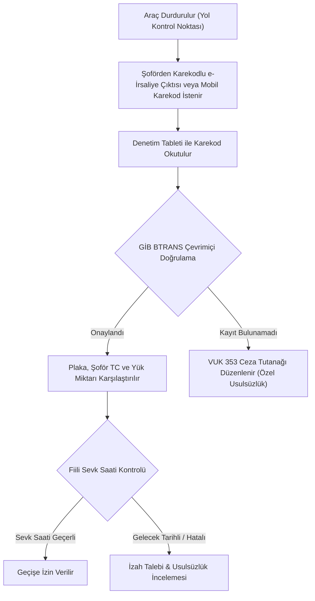

# 2026/2027 e-İrsaliye Geçiş Zorunluluğu, Ciro Limitleri ve Karekod Standartları 🚚📋

> **Kategori:** e-İrsaliye, Lojistik & Vergi Hukuku  
> **Hedef Kitle:** Şirket Ortakları, Mali Müşavirler, Lojistik Yöneticileri, ERP Uzmanları, Depo Şefleri  
> **Tahmini Okuma Süresi:** 7 dakika  
> **Son Güncelleme:** 2026  
> **Yasal Dayanak:** 509 Sıra No.lu VUK Genel Tebliği, GİB e-İrsaliye Uygulama ve Karekod Kılavuzu

---

## 📌 1. 2026/2027 Yılı e-İrsaliye Ciro ve Sektörel Geçiş Limitleri

Gelir İdaresi Başkanlığı (GİB) 509 Sıra No.lu VUK Genel Tebliği uyarınca, e-İrsaliye uygulamasına geçiş zorunluluğu kapsamı her yıl güncellenmektedir:

### 1. Genel Ciro Haddi:
- Brüt satış hasılatı **10 Milyon TL ve üzeri** olan tüm mükellefler, ilgili hesap dönemini takip eden yedinci ayın başından (1 Temmuz) itibaren e-İrsaliye uygulamasına geçmek zorundadır.

### 2. Sektörel Özel Zorunluluklar (Ciro Şartı Aranmaksızın):
* **Demir ve Çelik Sektörü:** Demir-çelik (GTİP 72) ile demir veya çelikten eşyaların (GTİP 73) üretimi, toptan alım-satımı veya ithalat-ihracatını yapan mükellefler.
* **Gübre Takip Sistemi (GTS):** Tarım ve Orman Bakanlığı Gübre Takip Sistemi'ne kayıtlı üretici, toptancı ve bayiler (kimyevi, organik gübre sevkiyatları).
* **Hal Kayıt Sistemi (HKS):** Yaş sebze ve meyve toptancıları, komisyoncuları ve sevkiyatçıları.
* **Özel Tüketim Vergisi (I) Sayılı Liste:** Petrol, akaryakıt, LPG, madeni yağ ve solvent dağıtıcıları, bayileri ve lisans sahipleri.
* **Özel Tüketim Vergisi (III) Sayılı Liste:** Tütün, sigara, alkollü içecek ve kolalı gazoz imalatçıları ile toptancıları.
* **Maden İşletmeleri:** Maden Kanunu kapsamında ruhsat sahibi olan veya maden zenginleştirme faaliyeti yürüten işletmeler.
* **Şeker İmalatçıları:** Şeker Kanunu kapsamında şeker fabrikaları ve toptan dağıtıcıları.
* **İlaç ve Tıbbi Cihaz:** Sağlık Bakanlığı İlaç Takip Sistemi (İTS) ve Ürün Takip Sistemi (ÜTS) kapsamındaki ecza depoları ve tıbbi cihaz dağıtıcıları.

---

## 📱 2. GİB Karekod (QR Kod) Teknik Standartları ve Zorunlu Alanlar

509 Sıra No.lu VUK Genel Tebliği uyarınca, e-İrsaliye üzerinde bulunması zorunlu olan karekod, belgenin **sağ üst köşesinde en az 2x2 cm boyutunda ve 300 DPI netliğinde** basılmalıdır.

### Karekod Veri Yapısı (Pipe `|` Ayracı ile):
```text
SATICI_VKN|ALICI_VKN|BELGE_NO|BELGE_TARIHI|BELGE_SAATI|SEVK_TARIHI|SEVK_SAATI|PLAKA|TOPLAM_TUTAR|HASH
```

### Örnek Karekod İçeriği:
```text
1234567890|9876543210|IRS2026000000412|2026-10-23|14:30:00|2026-10-23|15:00:00|34ABC123|145250.00|e3b0c44298fc1c149afbf4c8996fb92427ae41e4649b934ca495991b7852b855
```

### Zorunlu Alanlar:
1. **Satıcı ve Alıcı VKN/TCKN:** 10 veya 11 haneli kimlik numarası.
2. **Belge No:** 16 haneli benzersiz e-İrsaliye seri/sıra numarası (`IRS2026...`).
3. **Düzenleme Tarihi ve Saati:** e-İrsaliyenin sisteme iletildiği an.
4. **Fiili Sevk Tarihi ve Saati:** Aracın depodan/fabrikadan çıkış yaptığı an.
5. **Araç Plaka No (`LicensePlateID`):** Çekici ve varsa dorse plaka numarası.
6. **Kriptografik İmza Özeti (Digest Value):** e-İrsaliye UBL-TR XML imzasının SHA-256 hash'i.

---

## 🚔 3. Yol Denetimi ve Mobil Doğrulama Adımları

Yol denetimlerinde Gelir İdaresi Başkanlığı Denetim Elemanları veya Kolluk Kuvvetleri (Polis, Jandarma) araç üstü mobil tabletlerle aşağıdaki adımları icra eder:



### Denetim Tabletinde Çıkan Doğrulama Mesajları:
1. **🟢 "Belge GİB Sisteminde Kayıtlıdır ve Geçerlidir":** Belge onaylanmıştır, plaka ve yük bilgileri örtüşüyorsa araç yoluna devam eder.
2. **🔴 "Belge Bulunamadı / Sahte Karekod":** Karekod sahte veya GİB sistemine henüz iletilmemiştir. VUK Madde 353 uyarınca belge basılmamış sayılarak özel usulsüzlük cezası kesilir.
3. **🟡 "Fiili Sevk Zamanı Uyuşmazlığı":** Sevk tarihi henüz gelmemiş veya geçmiş tarihli sevklerde ceza riski doğar.

---

## ⚡ 4. Çevrimdışı (Offline) Sevkiyat ve Sistem Arızası Protokolü

İnternet bağlantısının veya GİB/Özel Entegratör sistemlerinin çöktüğü istisnai durumlarda sevkiyat şu kurallarla yapılabilir:

1. **Matbu Sevk İrsaliyesi Düzenleme:** Sistem çalışmıyorsa yedek matbu kağıt irsaliye düzenlenir ve üzerine *"Teknik İmkansızlık Nedeniyle Matbu Düzenlenmiştir"* şerhi düşülür.
2. **2 Saatlik Kural:** Sistemler normale döndüğü anda en geç **2 saat içinde** matbu irsaliyenin e-İrsaliye karşılığı düzenlenmeli ve açıklama alanına matbu irsaliyenin seri/sıra numarası yazılmalıdır.
3. **Karekodlu Kağıt Çıktı:** e-İrsaliye elektronik düzenlense dahi araçta **karekod içeren kağıt çıktısının** veya karekodun okunabileceği mobil cihazın (akıllı telefon/tablet) bulunması zorunludur.

---

## 🔍 5. e-İrsaliye XML Ayrıştırma ve Doğrulama Araçları

* 📄 [04-e-fatura-xml-goruntuleyici.html](../araclar/04-e-fatura-xml-goruntuleyici.html) - e-İrsaliye ve e-Fatura XML dosyalarındaki plaka, taşıyıcı ve sevk zamanını tarayıcıda görselleştiren yerel araç.
* 📑 [e-fatura-validator](https://github.com/eimza-kep/e-fatura-validator) - UBL-TR 1.2.1 e-İrsaliye şema ve schematron doğrulayıcı.
* 📨 [kep-adresi-dogrulayici](https://github.com/eimza-kep/kep-adresi-dogrulayici) - İrsaliye itirazlarında KEP adresi format kontrolcüsü.
